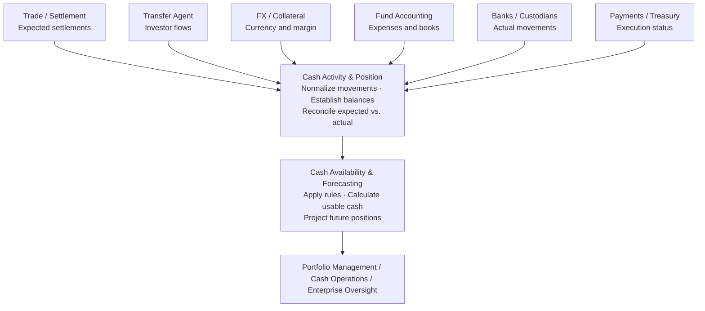

# Cash Management: Four Foundational Concepts

*A practical, industry-neutral architecture guide to cash activity, cash position, cash availability, and cash forecasting, illustrated with one investment fund and an end-to-end systems view.*

> **Central idea:** The four concepts are different views of the same underlying cash lifecycle: events, resulting balances, usable funding capacity, and future projections.

| Concept | Question answered | Definition |
|---|---|---|
| **Cash activity** | What changes cash? | Actual or expected receipts and payments tied to business events. |
| **Cash position** | What is the balance at a point in time? | Starting cash plus the relevant actual or projected cash movements. |
| **Cash availability** | How much can be used safely? | Funding capacity after applying obligations, restrictions, reserves, and timing. |
| **Cash forecasting** | What will cash look like later? | A sequence of projected cash positions based on future activity and assumptions. |

The distinction is easiest to understand by starting with an opening bank balance, introducing real investment-operating events, and following the same cash through the daily workflow.

**Scope:** Portfolio-level cash management for a hypothetical investment manager. This guide uses generic system and capability names; it does not describe any specific company's implementation.

*All examples, amounts, and times are hypothetical.*

---

## 1. One fund, one operating day

Assume a hypothetical multi-asset mutual fund holds equities, bonds, foreign-currency investments, and derivatives. It starts Monday with **$100 million of settled USD cash** in a custodian account. The fund also receives shareholder investments and redemptions.

| Expected time | Business event | USD impact |
|---|---|---:|
| 10:00 AM | Securities purchases settle | -$35M |
| 10:30 AM | Bond coupon received | +$4M |
| 12:30 PM | FX settlement: USD leg paid | -$8M |
| 2:00 PM | Shareholder redemptions paid | -$22M |
| 3:00 PM | Variation margin paid | -$12M |
| 4:00 PM | Securities sales settle | +$18M |
| 5:00 PM | Fund expenses paid | -$3M |

**Projected closing cash:**

\[
\$100\text{M opening} + \$22\text{M inflows} - \$80\text{M outflows}
= \boxed{\$42\text{M}}
\]

The FX transaction also creates a separate receipt in a different currency. The table assumes each movement occurs at the stated time.

### Systems participating in the example

| Source system / capability | Relevant knowledge | Information supplied to cash management |
|---|---|---|
| **Bank / custodian** | Posted cash balances and payments | Opening cash, bank debits/credits, settlement evidence |
| **Fund accounting** | Official books and accounting adjustments | Accounting cash, expense obligations, reconciliation context |
| **Trade and settlement** | Purchases, sales, settlement instructions | Expected dated cash receipts and payments; status updates |
| **Transfer agency** | Fund subscriptions and redemptions | Expected and confirmed investor flows |
| **FX trading / collateral** | Currency trades and margin calls | Multi-currency movements and margin obligations |
| **Payments / treasury** | Approved payments and execution state | Instructions, acknowledgments, execution confirmations |

---

## 2. Cash activity: what changes cash?

A **cash activity** is an actual or expected movement of money for a specific portfolio/account and currency on a defined value date. It is the lowest-level business information needed to explain how a cash balance changes.

A securities purchase settling for $35 million first creates an **expected outflow**. Once the custodian reports the corresponding debit, that payment becomes an **actual cash movement**. The two records are related evidence of one obligation, not two separate outflows.

### Example activity record

| Attribute | Value |
|---|---|
| Portfolio | Multi-Asset Fund A |
| Activity type | Securities purchase settlement |
| Source | Trade and settlement system |
| Impact | -$35,000,000 USD |
| Expected time | Monday, 10:00 AM |
| Status at 9:00 AM | Expected / pending settlement |
| Business reference | Trade settlement identifier |

> **Critical rule:** Match the $35M expected settlement to the $35M actual bank debit. Do **not** deduct both independently from the projected position.

### Information every cash activity should preserve

- **Business owner:** Portfolio/fund, legal entity, cash account, and currency.
- **Source:** Originating event and source transaction identifier.
- **Timing:** Trade date where relevant, cash value date, expected time, and observed posting time.
- **Lifecycle:** Estimated, confirmed, settled, cancelled, or adjusted.
- **Reconciliation:** Relationship to bank evidence, unmatched items, and operational exceptions.

For FX, a single trade can create multiple currency-specific activities. For example, the USD payment and an associated EUR receipt must remain separate cash legs with explicit accounts and currencies.

---

## 3. Cash position: the balance at a stated time

**Cash position is a balance, not a new source event.** It is derived from a starting cash balance plus movements that apply through the selected point in time.

\[
\text{Cash position at time }t
= \text{Opening cash} + \sum_{\text{activities effective through }t}\text{Cash activity}
\]

### Actual position versus projected position

- **Actual bank cash:** Posted/settled cash at a stated time.
- **Projected cash:** Expected balance after future events.
- **Official accounting cash:** Balance in the investment books, which may differ temporarily due to timing and reconciliation items.

### Monday intraday projected balances

| Time | Event applied | Projected USD balance |
|---|---|---:|
| 9:00 AM | Opening balance | $100M |
| 10:00 AM | Security purchases | $65M |
| 10:30 AM | Coupon receipt | $69M |
| 12:30 PM | FX payment | $61M |
| 2:00 PM | Shareholder redemption | $39M |
| 3:00 PM | Margin payment | **$27M (intraday low)** |
| 4:00 PM | Security sale receipt | $45M |
| 5:00 PM | Expenses | **$42M (projected close)** |

At **1:00 PM**, if the 10:00 AM, 10:30 AM, and 12:30 PM events have actually posted, bank cash is **$61M**, while expected end-of-day cash is **$42M**. Both are valid; they answer different questions.

---

## 4. Cash availability: capacity to fund another obligation

A cash position alone does not indicate what the investment manager can use. **Cash availability is a decision-oriented measure:** how much can be committed to a particular purpose, account, currency, and funding date without breaching known obligations or constraints?

Suppose policy requires at least **$20 million of operating cash throughout Monday**. The lowest projected intraday cash position is $27 million, at 3:00 PM.

| Availability calculation | USD amount |
|---|---:|
| Lowest projected intraday balance | $27M |
| Required cash reserve | -$20M |
| **Additional same-day funding capacity** | **$7M** |

If a portfolio manager proposes another purchase requiring **$10 million** of additional same-day cash, the projected reserve cushion becomes:

\[
\$27\text{M low point} - \$20\text{M reserve} - \$10\text{M new payment}
= \boxed{-\$3\text{M}}
\]

That is a **$3M shortfall against the reserve**.

### What the availability result must consider

- **Timing:** A receipt at 4:00 PM cannot fund an obligation due at 2:00 PM without another permitted funding arrangement.
- **Currency:** Available USD does not automatically satisfy a EUR obligation.
- **Ownership:** Cash from a separate fund or legal entity is not automatically transferable.
- **Restrictions and reserve policy:** Some cash may be blocked, pledged, earmarked, or needed for operational safeguards.
- **Receipt confidence:** A predicted coupon, trade settlement, or investor payment might not arrive on time.

> Under the stated assumptions, the same-day capacity is **$7M**. If the $4M coupon is not considered usable until confirmed, a conservative calculation could reduce that capacity to **$3M**.

Availability for a trade settling tomorrow should use the **projected position and funding rules for tomorrow**, not simply today's bank balance.

---

## 5. Cash forecasting: how balances evolve

**Cash forecasting** applies known, expected, and scenario-based events to the current position to project balances on future dates. It is not a separate set of cash transactions; it is a different evaluation of the activity and position model.

### Four-day example

| Date | Expected inflows | Expected outflows | Forecast closing cash |
|---|---|---|---:|
| Monday | Included in daily activity | Included in daily activity | $42M |
| Tuesday | $2M income | $15M settlements | $29M |
| Wednesday | $12M sale settlements | $10M redemptions | $31M |
| Thursday | $0 | $3M expenses | $28M |

Monday is the base-case projected close, **not necessarily settled bank cash**. Tuesday through Thursday show forecast positions under the stated assumptions.

### What if a sale does not settle on time?

Assume the expected **$18M sale receipt** at 4:00 PM Monday is delayed to Tuesday. Monday projected closing cash falls from **$42M to $24M**. If the receipt arrives Tuesday, Tuesday's projected closing cash can still be **$29M** under otherwise unchanged assumptions. Nevertheless, Monday and Tuesday intraday funding exposure will be different.

| Scenario | Monday projected close | Why it matters |
|---|---:|---|
| Base case | $42M | Assumes all expected Monday receipts and payments occur. |
| $18M sale receipt delayed | $24M | Greater Monday funding risk; Tuesday balance depends on revised receipt timing. |

### Forecast certainty is not uniform

| Category | Example | Treatment |
|---|---|---|
| Confirmed obligation | Executed securities purchase due to settle | Include with settlement risk and current status. |
| Expected flow | Estimated shareholder subscriptions | Include with forecast confidence / uncertainty. |
| Scenario | Proposed additional purchase | Keep separate unless approved or committed. |

The long-range forecast may be less precise than the short-range forecast. A platform should expose assumptions, revision history, exceptions, and the source of each material projected movement.

---

## 6. How the systems work together

The architecture can separate the capability that understands and reconciles cash movements from the capability that applies availability policies and evaluates future funding. **This is a logical split; it does not require two applications.**

Source systems remain authoritative for their originating events. The cash activity/position capability reconciles expected and actual cash; availability/forecasting applies rules and evaluates timing and uncertainty.

### Suggested responsibility boundary

| Capability | Responsibilities | Outputs |
|---|---|---|
| **Cash activity and position** | Normalize expected and actual movements; reconcile to bank evidence; maintain balance views; manage breaks. | Dated cash events, matched transactions, actual and projected cash positions. |
| **Availability and forecasting** | Apply funding eligibility, reserves and restrictions; project future positions; evaluate funding requests and scenarios. | Usable cash, projected cash curves, funding gaps and scenario results. |

Fund accounting remains authoritative for official books. Trade, transfer-agency, FX, collateral, and payments systems retain ownership of their respective business transactions.

---

## 7. Follow the events through the operating day

| Time | Event / decision | Primary responsibility |
|---|---|---|
| 8:00 AM | Custodian provides $100M opening settled balance. | Bank / custodian |
| 8:15 AM | Operations reconciles opening cash against expected movements and accounting information. | Cash operations; fund accounting |
| 9:00 AM | Cash system assembles trade, investor, FX, collateral, and expense activity. | Cash activity / position |
| 9:15 AM | System calculates $27M intraday low point and $7M incremental capacity. | Availability calculation |
| 9:30 AM | Proposed additional $10M purchase creates $3M reserve shortfall. | Portfolio management; availability |
| 10:00 AM onward | Bank postings are matched to expected items; projected position updates. | Bank; reconciliation |
| 1:00 PM | Bank position is $61M assuming earlier items posted. | Bank / custodian; cash position |
| 3:00 PM | Expected $12M margin payment takes projected position to $27M. | Collateral system; position calculation |
| 4:00 PM | Sale proceeds either arrive or remain outstanding as an exception. | Settlement; bank; cash operations |
| End of day | Compare expected with actual; resolve breaks; refresh future projections. | Cash operations; forecasting |

### Why an operational ledger helps

An operational record of cash events should connect the original business obligation, its expected cash effect, the actual bank movement, and any correction or exception. **It is not a substitute for official investment accounting; it is an explanation of cash activity and its effect on operational balances.**

---

## 8. Extend the same concepts across investment products

The core definitions apply to a variety of investment products, but source systems and specialized rules can remain different.

| Product / activity | Example cash event | Architectural treatment |
|---|---|---|
| **ETF** | Cash component from a creation or redemption. | Translate primary-market activity into dated cash flows; preserve ETF-specific processing elsewhere. |
| **Collective investment trust (CIT)** | Net contributions or withdrawals from participating plans. | Record expected trust-level cash movements and apply trust funding rules. |
| **Fund of funds** | Parent fund purchases units in an underlying fund. | Preserve each fund's independent activity; link related flows without improperly netting. |
| **Money-market fund** | Short-term instrument matures tomorrow. | Project the receipt; keep specialized liquidity and maturity compliance separate. |
| **Private-market fund** | Underlying investment generates a capital call. | Specialist commitment system generates the future obligation; the cash system may consume its dated flow. |

### Four architectural rules

1. **Do not double-count.** Match the expected cash activity to the eventual realized bank debit or credit.
2. **Always state the position context.** A cash balance without portfolio, account, currency, value date, timestamp, and status is not decision-ready.
3. **Availability is not bank balance.** Apply obligations, timing, eligibility, ownership, and reserves before declaring cash usable.
4. **Expose uncertainty in forecasts.** Confirmed flows, estimates, and what-if scenarios are different kinds of information.

> **Principle:** A shared cash information model does not require a single operational platform across every product family. Share contracts and semantics where useful; retain specialized business processing where appropriate.

---

## 9. The conceptual model and architecture questions

| Concept | Example | Primary output |
|---|---|---|
| **Cash activity** | -$35M purchase, +$4M coupon, -$22M redemption | Dated cash movements and their status |
| **Cash position** | $100M opening; $61M actual at 1:00 PM | Balance at an explicit timestamp |
| **Cash forecast** | $42M Monday, $29M Tuesday | Projected position over time |
| **Cash availability** | $7M further same-day capacity under stated assumptions | Usable amount for a purpose and date |

### Questions for architecture discovery

- Where is the trusted opening cash balance established, and how is it reconciled?
- Do multiple applications independently collect the same cash movements and calculate competing cash positions?
- How are expected settlement records matched to actual bank postings?
- Who owns adjustments, corrections, cancellation events, and unmatched cash items?
- Where are cash eligibility, reserve, and funding restrictions defined and maintained?
- Can users trace every forecast change to a source event, assumption, or reconciliation update?
- Can a portfolio manager evaluate a proposed funding requirement for a specific fund, currency, and settlement date?

### A clear division of responsibilities

If one capability owns activity normalization, bank reconciliation, and the trusted operational cash position, another capability can responsibly own availability rules and forecasting scenarios. **That is a defensible separation.**

If both reconstruct overlapping cash movements and maintain contradictory balance views, the primary modernization opportunity is to remove duplicated interpretation and improve data ownership—not necessarily to replace the applications.

> **Remember:** Cash activity tells us **what changes**. Cash position tells us **the balance**. Cash forecasting tells us **how that balance evolves**. Cash availability tells us **what can be safely used**.

---

*End of guide. All examples, amounts, and times are illustrative.*
